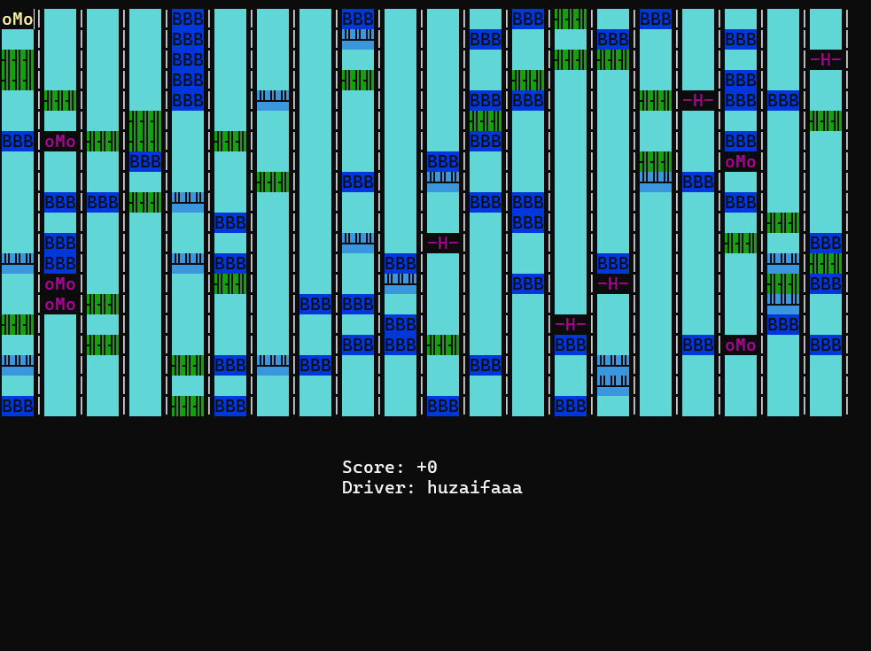
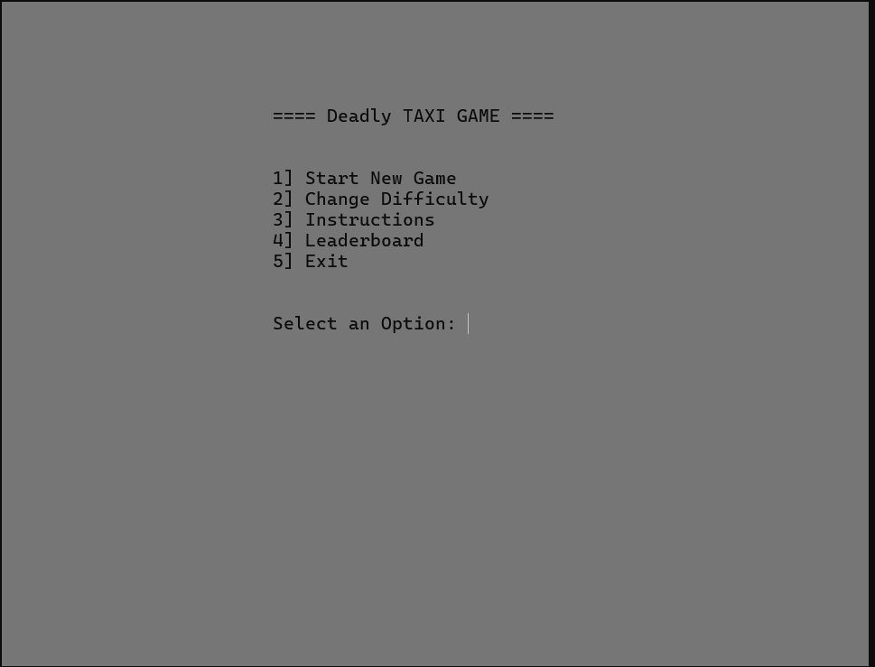
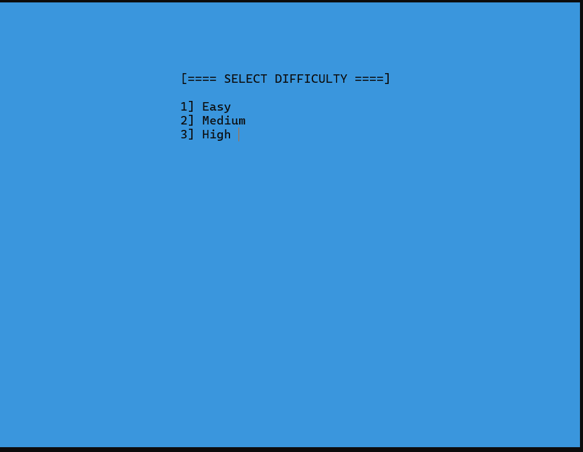
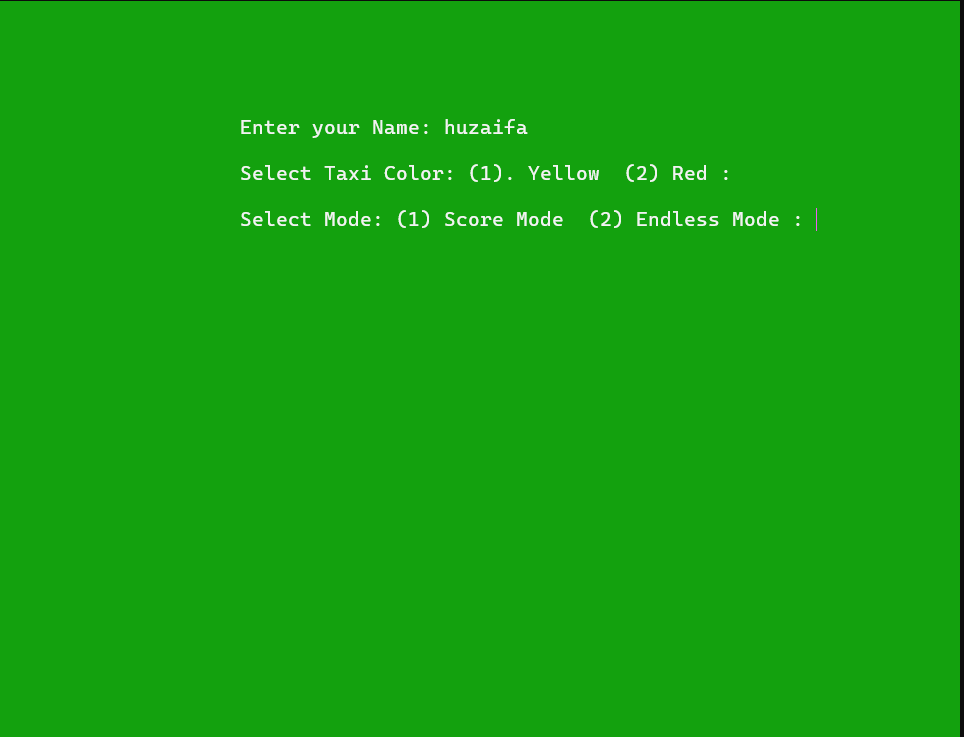
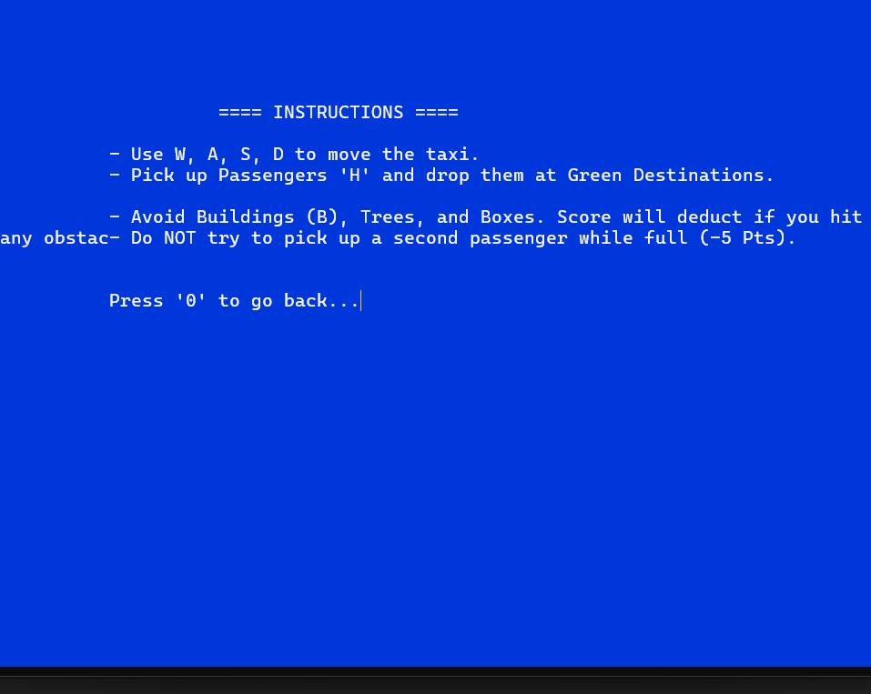
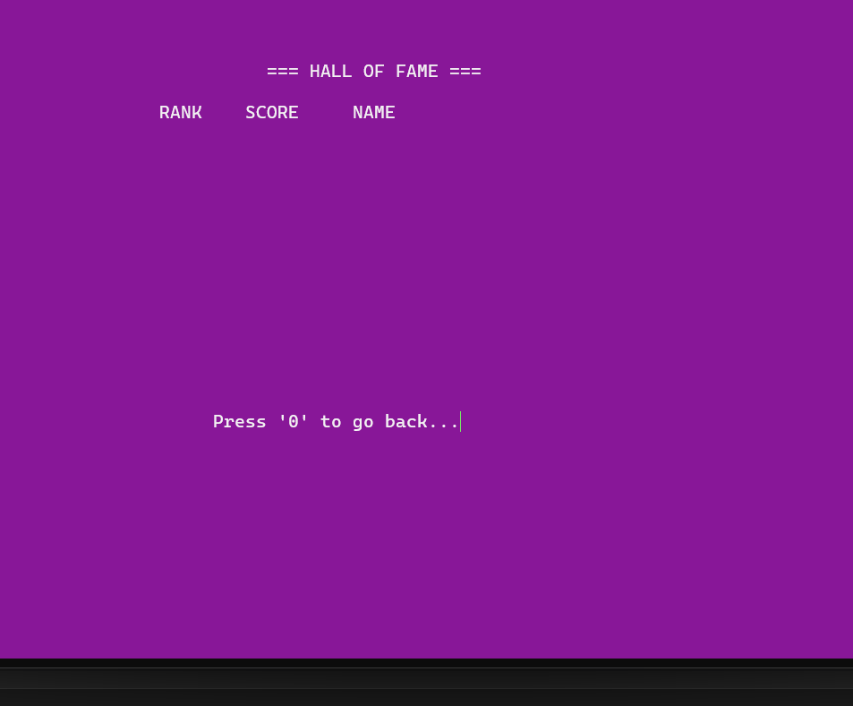
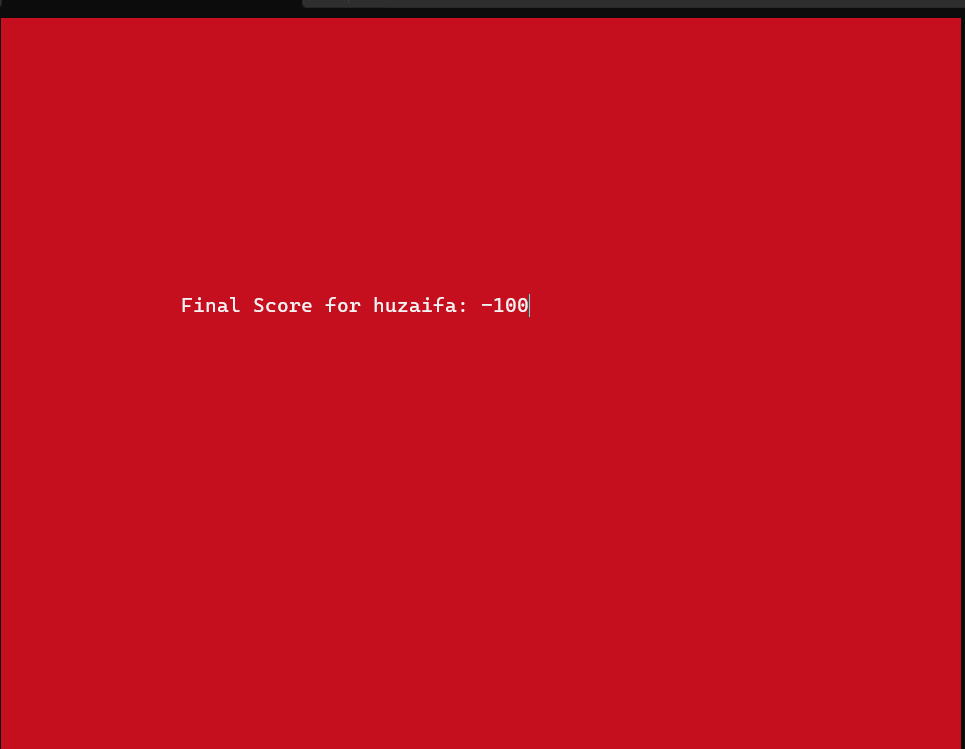
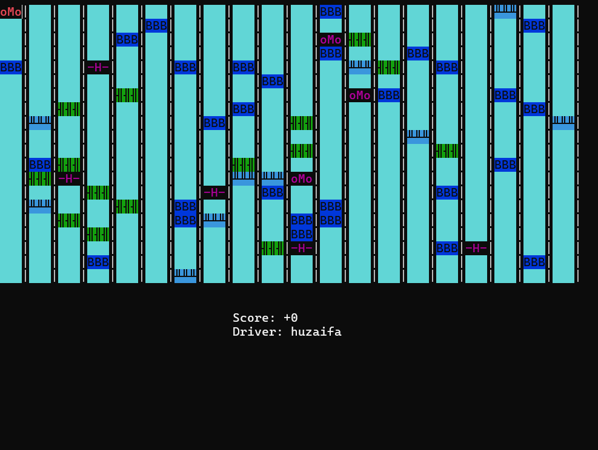
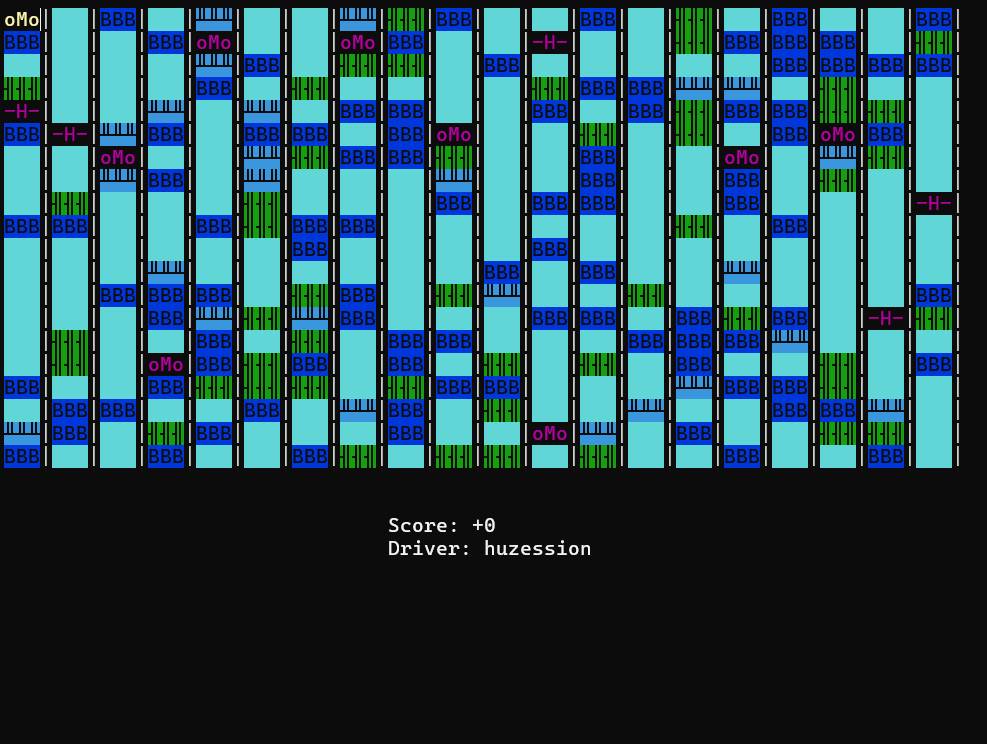

# 🚕 Deadly Taxi – A Console Taxi Game in x86 Assembly (MASM + Irvine32)

A taxi-driving game written entirely in **32-bit x86 assembly** (MASM) with the **Irvine32** library. I built it as my semester project for **Computer Organization & Assembly Language (COAL)** at FAST-NUCES Islamabad.

You drive a taxi around a randomly generated 20 × 20 city of buildings, trees, boxes and parked cars. You pick up passengers and drop them at their green destinations, and every crash costs you points. The game has menus, three difficulty levels, two game modes and a top-10 leaderboard, all drawn in the Windows console with coloured characters.

<p align="center">
  <br>
  <em>The taxi (top-left), passengers <code>-H-</code>, buildings <code>BBB</code>, trees, boxes and NPC cars <code>oMo</code></em>
</p>

---

## ✨ Features

- **Full menu system:** main menu, difficulty selection, instructions, leaderboard, player setup and an end screen, each with its own colour theme
- **Randomly generated city:** a fresh board every game, built from a 400-byte array that represents the 20 × 20 grid
- **Three difficulty levels:** each one changes how many obstacles are placed

  | Level | Buildings | Trees | Boxes | NPC cars |
  |---|---|---|---|---|
  | Easy | 30 | 15 | 10 | 3 |
  | Medium | 55 | 27 | 15 | 5 |
  | High | 100 | 40 | 25 | 8 |

- **Two game modes:**
  - **Score Mode:** win by reaching **+100**
  - **Endless Mode:** keep driving with no score cap
- **Passenger system:** 5 passengers at the start. After you pick one up, a random destination appears, and a new passenger spawns after each drop-off
- **Customisation:** enter your name and choose a yellow or red taxi
- **Pause and quit:** pause at any time, or quit to the menu with your score saved
- **Top-10 leaderboard ("Hall of Fame"):** sorted from highest to lowest score with a bubble sort written in assembly

## 🎮 Controls

| Key | Action |
|---|---|
| `W` `A` `S` `D` | Move the taxi |
| `P` | Pause / resume |
| `X` | Quit to the main menu (your score is saved to the leaderboard) |
| `1`–`5` | Choose menu options |
| `0` | Go back from the Instructions and Leaderboard screens |

## 📜 Scoring

| Event | Points |
|---|---|
| Drop a passenger at their destination | **+10** |
| Hit a box | −2 |
| Hit a building | −4 |
| Hit a tree | −5 |
| Try to pick up a second passenger while carrying one | −5 |
| Crash into an NPC car | **−10** |

When you crash, your taxi doesn't move into that cell. **The game ends** at **−100** (you lose), or at **+100** in Score Mode (you win).

## 🧠 Assembly Concepts Used

- **The board as a 1D array:** the 20 × 20 grid is a flat `BYTE` array, and each cell holds a code for what's there (0 = road, 1 = building, 2 = tree, 3 = box, 5 = NPC car, 8 = passenger, 9 = destination)
- **Index arithmetic for movement:** up and down move by ±20. Left and right use `DIV` by 20 to check the column and stop the taxi at the edges
- **Collision detection:** compares the code in the target cell before moving
- **Signed arithmetic:** the score is an `SDWORD`, checked with `JLE` and `JGE` against ±100
- **Procedures:** the code is split into `PROC`s such as `DrawCar`, `EraseCar`, `SpawnNewPassenger`, `GenerateDestination`, `UpdateLeaderboard` and `SortLeaderboard`
- **Parallel arrays:** the leaderboard keeps scores (`SDWORD[10]`) and names (`BYTE[10 × 30]`) side by side. The bubble sort swaps both together, copying the name strings with `ESI` and `EDI`
- **Irvine32 console I/O:** `Gotoxy`, `SetTextColor`, `WriteChar`, `WriteString`, `ReadChar`, `ReadString`, `RandomRange` and `Randomize`
- **Extended ASCII graphics:** trees, boxes and destinations are drawn with block characters (176, 178, 182, 208)

## 🖼️ Screenshots

| Main menu | Difficulty | Player setup |
|---|---|---|
|  |  |  |

| Instructions | Leaderboard | Game over |
|---|---|---|
|  |  |  |

| Easy board | Medium board | High board |
|---|---|---|
|  |  |  |

## 🛠️ Build & Run (Windows)

The game needs **Visual Studio** (with the *Desktop development with C++* workload, which includes MASM) and the **Irvine32 library**.

1. Download and install Irvine32 from [asmirvine.com](http://asmirvine.com/). The default location is `C:\Irvine`.
2. Open the Irvine sample project (`Project32_VS2022`), or set up a MASM project yourself:
   - right-click the project → **Build Dependencies → Build Customizations** → tick **masm**
   - **Linker → General → Additional Library Directories:** `C:\Irvine`
   - **Linker → Input → Additional Dependencies:** add `irvine32.lib`
   - **Microsoft Macro Assembler → General → Include Paths:** `C:\Irvine`
3. Add `DeadlyTaxi.asm` to the project, then build and run with **Ctrl + F5**.

> For the board to fit, maximise the console window or make it at least 60 columns × 25 rows.

## 📁 Project Structure

```
.
├── DeadlyTaxi.asm   # The whole game: menus, board generation, game loop, leaderboard
└── screenshots/
```

## 🚀 Possible Improvements

- Save the leaderboard to a file so it survives restarts (at the moment it's kept in memory)
- Make the NPC cars move around the map
- Add a timer, and fuel stations like the C++ (OOP) version of Rush Hour

## 👤 Author

**Muhammad Huzaifa**
